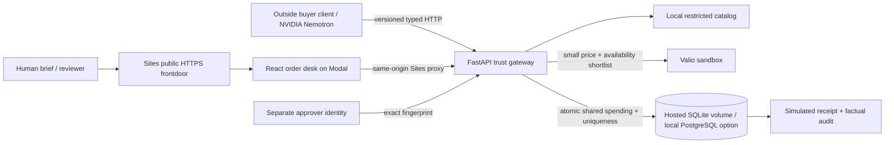

# A4TB · Valio Aimo

**Good judgment. On the record.** Describe a kitchen's purchasing needs, compare catalog products and review a complete simulated basket. Deterministic checks enforce quantities, dietary evidence, budget and delivery; permitted spend exceptions require exact separate approval.

Built for Junction 2026's Valio Aimo Trusted Trade Agents challenge. **All orders are simulated. No final Junction submission was performed; the last observed entry was Draft. Source remains private.**

## Hosted application

Open **[A4TB · Valio Aimo](https://a4tb-valio-aimo.cozyhawthorn4.chatgpt.site)** and use the private buyer/approver codes from this installation's ignored `.local/access.json`. This public Sites frontdoor proxies the application on Modal; the source repository, runtime secrets and restricted catalog remain private. Never put codes in URLs or public messages. All orders remain simulated.

**Smart order** is the primary workflow: type, speak or upload a shopping list, edit the extracted text, compare catalog candidates and package surplus, sort/filter alternatives, save preferences, change quantities/budget/date, resolve choices, and confirm a complete priced basket. Unresolved constraints block checkout. **Meal planner** supports editable recipes and transfers a saved plan with its selections into the same quotation/cart workflow. **Trust scenarios** retains the original milk approval/repair demo in the shared workspace.

See [implementation and acceptance plan](docs/IMPLEMENTATION_PLAN.md) and [hosting details](docs/DEPLOYMENT.md).

## Run

Prerequisites: Node.js 20.19+ or 22.12+, npm, Python 3.12+, and [uv](https://docs.astral.sh/uv/). The prepared machine already has these. From this project:

```bash
./start.sh
```

Open **http://127.0.0.1:8000**. Open your desk with the **buyer** code from ignored `.local/access.json`, or use that invitation under **Create workspace** for a separate username/password account. To approve an exception, sign in separately using the **approver** code; a private workspace's approval shortcut fills its scope. Codes are never bundled into frontend assets. Sessions last eight hours, or 30 days with **Remember me**; hashed tokens, expiry and revocation persist across server restarts. Registration creates an isolated simulator workspace, not a supplier customer contract.

`start.sh` installs the pinned Python dependencies, prepares public OCR/speech assets when absent, builds React and serves FastAPI. First setup requires network access. For a prepared offline fallback, use `AIMO_STORAGE=sqlite ./start.sh`, select **Rehearsal fixture** prices/stock and leave NVIDIA unchecked. This needs the supplied static catalog but makes no NVIDIA or Valio API requests. NVIDIA interpretation is an independent option; fixture prices alone do not disable that request. The optional NVIDIA trial is for nonconfidential demo content only.

The prepared `.env`, `.local/aiven-ca.pem` and `data/raw/` are preserved and ignored. A fresh clone requires the challenge-restricted catalog obtained legitimately through the resource portal. Do not commit or redistribute it. `.env.example` documents optional integration names; never paste credentials into browser URLs or frontend code.

## Try the customer workflow

1. Use **Smart order** and request “20 litres of lactose-free milk and 5 kilograms of butter by Monday. Budget €200.” Choose fixture or live sandbox pricing explicitly.
2. Inspect product evidence, package surplus and alternatives. **Sort & filter products** changes discovery; **Choose** changes the basket. **Buying preferences** saves soft defaults for future carts.
3. Try **Speak your order**, **Add photo or list**, or **Upload audio**. Review and edit the transcript before adding it. Local Tesseract and Whisper are the defaults; media never directly changes a cart.
4. Lower the budget to €1 and observe the block, then use an offered correction. Review the complete cart and confirm a **simulated** order. Verify and reload the saved receipt.
5. Use **Meal planner** for the 500-diner bolognese example. Dietary overlap must be explicit, the proposed recipe needs chef review, and missing catalog claims remain blockers.

The step-by-step [plain-text checking guide](docs/WEBSITE_CHECK_GUIDE.txt) includes accounts, Remember Me, media, manager approval and expected failures.

## Retained trust rehearsals

1. Sign in as buyer. Leave at least 1,000 L, Monday 16 November 2026, and lactose-free milk. Run **Clear runway** in labelled fixture mode. Inspect every check and commit a simulated order. Retry: the same receipt returns, without spending again.
2. Select **The milk runs out**. The controlled shortage blocks the preferred €1,150 offer. The €1,870 UHT alternative preserves diet/date/quantity, but exceeds the authored €1,400 autonomous limit. Sign in as the separate approver, approve that exact fingerprint, sign back in as buyer and commit.
3. Select **The offer changes**. Inspect the expired offer, then **Refresh this exact offer**. Revalidation produces a new fingerprint and clears any inherited approval. The comparison shows what changed.
4. Try **A tempting shortcut**, **An untrusted instruction**, or **Quantity unknown**. Hard dietary evidence and unknown stock cannot be overridden by a human budget approval.
5. Switch to **Live sponsor sandbox**. Enable NVIDIA Nemotron for an actual typed shortlist; deterministic gateway code independently validates the result. A non-baseline scenario explicitly overlays a controlled failure on live evidence. Run it only when network access is available.

The brief's typed quantity and date are authoritative; free text provides context, not a way to change the hard mandate. These typed controls apply to the original milk Trust scenarios. Smart order extracts multi-product requirements from free text and uses a separate customer-confirmed basket policy; it does not widen the milk agent's authority.

## Outside agent and open API

Interactive OpenAPI: **http://127.0.0.1:8000/docs**. Contract: `/openapi.json`; health: `/health`.

```bash
.venv/bin/python scripts/agent_client.py --mode fixture --commit
.venv/bin/python scripts/agent_client.py --mode live --model --commit
```

The independent Python client signs in as the buyer, searches real IDs over HTTP, uses NVIDIA's `propose_candidates` typed tool, sends those candidate IDs to the gateway, commits only a permitted offer, retries and verifies the same receipt. It cannot approve itself. Detailed reports remain ignored in `.local/`.

## Architecture



Authority belongs to the server. The original milk scenario has a chef-approved assortment and mandatory lactose-free evidence. Smart order uses a separate customer-confirmed basket policy with item-level dietary/origin constraints. Both enforce buyer/customer/approver scope, dimensional pack conversion, whole-pack lot steps, EUR tax-inclusive Decimal amounts, date/cutoff/sales-block/quantity/freshness checks, five-minute quote expiry and a shared €6,000 synthetic cumulative cap. Atomic transactions and uniqueness constraints enforce spending and idempotency. Approvals bind the exact buyer, products, quantities, date, subtotal, evidence and expiry. Changed facts require a new quote and approval.

The hosted Modal application deliberately uses persistent SQLite in a private volume and one writer. Accounts, preferences, sessions, carts, approvals, receipts and synthetic spend survive restarts. The local Aiven PostgreSQL option uses full hostname/CA verification and at most two concurrent connections; an unavailable local connection is explicitly reported as SQLite fallback. The Aiven allowlist was not widened for hosting. Catalog search runs in the backend. Optional NVIDIA receives the request and necessary prior structured intent, or a short candidate list for the external-agent shortlist; never the full catalog or credentials. Image transmission to NVIDIA needs separate explicit consent. Actual deployed NVIDIA interpretation and Valio reads were tested successfully; failures remain visible.

## Verify

```bash
.venv/bin/python -m pytest -q
.venv/bin/python scripts/backend_smoke.py
.venv/bin/python scripts/backend_postgres_check.py
npm run build --prefix frontend
# Hosted extension: isolated QA accounts; simulated spending only:
.venv/bin/python scripts/extended_smoke.py --url https://a4tb-valio-aimo.cozyhawthorn4.chatgpt.site --live
# Optional local browser checks (browser download required once):
uv pip install --python .venv/bin/python -r requirements-browser.txt
.venv/bin/python -m playwright install chromium
.venv/bin/python scripts/browser_verify.py
```

The Postgres check uses an isolated temporary schema and concurrency; it never resets the shared demonstration ledger. See [delivery](docs/DELIVERY.md) for exactly executed checks and current limitations. Browser checks must use the synthetic simulator; repeated local QA should use an isolated temporary ledger.

Demo commitments consume the shared synthetic cap. For a clean rehearsal, first save any ignored evidence reports you need, then deliberately reset **only** prototype simulator records:

```bash
.venv/bin/python scripts/backend_reset.py --confirm-example-data
```

This operator command is never exposed over HTTP and never runs automatically during retries. It resets only the shared simulator's offers, approvals, orders/audit and synthetic spend. Registered private accounts, their preferences, sessions, carts and receipts are preserved.

## Live, controlled and simulated

- **Live sponsor sandbox:** actual authenticated Valio price/availability reads. These are synthetic challenge commercial facts, not production offers or reservations.
- **NVIDIA agent:** optional hosted Nemotron 3.5 Lightning 30B-A3B typed interpretation, or a function-call shortlist in Trust scenarios. The selected text model passed 7/7 authored cases and 18/18 checks in the final small benchmark; this is not a general accuracy claim. Optional Super VL image reading requires separate consent. Invalid output/provider failures remain visible; deterministic policy still applies.
- **Speech and OCR:** server-local pretrained Whisper base and Tesseract; editable output, bounded uploads, no stored recordings/images, and no automatic cart mutation. Actual public-site microphone transcription was confirmed by the owner.
- **Rehearsal fixture:** authored dynamic prices/availability, visibly labelled; real supplied catalog metadata is still used. No silent network fallback.
- **Controlled failures:** named overlays on fixture or live evidence. Their injected fields are recorded explicitly.
- **Order/approval gateway:** our implementation. No published sponsor order endpoint is used. No payments, real purchases or supplier orders occur.
- **Receipt verification:** gateway-held record consistency and offer hash, not a digital signature, product safety certification, future stock guarantee or proof of delivery.

Delivery reliability means historical delivered quantity ratio, not on-time probability. Carbon is a group-average estimate per kilogram; the app makes no litre-to-kilogram assumption or invented carbon savings. Lactose-free milk is not milk-allergy safe.

## Review assets

- [Product and concept choice](docs/PRODUCT.md)
- [Current model evaluation and trade-offs](docs/AI_MODEL_SELECTION.md) and [actual NVIDIA usage](nvidia_usage.txt)
- [Extended acceptance evidence](docs/EXTENDED_ACCEPTANCE.md)
- [Two-minute demo and pitch scripts](docs/DEMO.md)
- [87-second local fixture demo](.local/demo/aimo-order-desk-draft.mp4) (local artifact; not uploaded)
- [Local draft pitch PDF](docs/pitch/aimo-order-desk-draft.pdf) and [editable deck](docs/pitch/aimo-order-desk-draft.pptx)
- [Submission copy — DRAFT](docs/SUBMISSION_DRAFT.md)
- [Sponsor evidence and credit ledger](docs/SPONSORS.md)
- [Hosted architecture and operating limits](docs/DEPLOYMENT.md)
- [Current status](PROJECT_STATUS.md) and [delivery / wake-up review](docs/DELIVERY.md)

A commercial rollout needs real customer mandates, identity federation, distributed limits for horizontal scaling, broader load/device testing, supported deposits/variable-weight charges, provider terms suitable for confidential customer data, and an actual wholesaler order contract. This deployed challenge prototype does not claim production certification or measured customer savings. Event source-access/MIT requirements and challenge-data restrictions remain separate from this private source release.

## Worker-interview update

Open **Meal planner** for the new bolognese/lentil planning workflow: editable recipe quantities, overlapping dietary cohorts, sourcing preferences, local catalog candidates, evidence gaps and a draft JSON shopping plan. The detailed planner keeps its draft export and can now quote a saved plan into Smart order, carrying ingredient quantities, dietary cohorts, source and selected products. The complete basket requires fresh validation and explicit recipe review before simulated confirmation.

Customer spend thresholds can be set by the operator using `AIMO_AUTONOMOUS_LIMIT`, `AIMO_EXCEPTION_LIMIT`, and `AIMO_CUMULATIVE_LIMIT` in the ignored environment (EUR, restart required). Policy changes invalidate uncommitted offers/approvals. See [interview requirements, delivered changes and remaining gaps](docs/INTERVIEW_GAPS.md).
