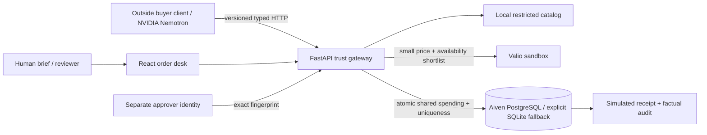

# Aimo Order Desk

**Good judgment. On the record.** An outside purchasing agent finds a way through a kitchen's mandate. A receiving gateway decides whether to commit autonomously, request exact human approval, or block a hard-rule failure.

Built for Junction 2026's Valio Aimo Trusted Trade Agents challenge. **All orders are simulated. Junction entry remains Draft; nothing has been submitted. Source remains private.**

## Run

Prerequisites: Node.js 20.19+ or 22.12+, npm, Python 3.12+, and [uv](https://docs.astral.sh/uv/). The prepared machine already has these. From this project:

```bash
./start.sh
```

Open **http://127.0.0.1:8000**. Open your desk and use a generated **buyer** access code from the ignored `.local/access.json`. To approve an exception, sign in separately using the **approver** code from that file. Codes are never bundled into frontend assets. Do not publish them. Sessions last eight hours and end when the single server process restarts.

`start.sh` builds the React frontend and serves it from FastAPI. Dependencies install only when absent. For a complete offline sponsor-independent fallback, use `AIMO_STORAGE=sqlite ./start.sh` and select **Rehearsal fixture**. Local fixture mode still needs the supplied static catalog; it makes no NVIDIA or Valio API requests.

The prepared `.env`, `.local/aiven-ca.pem` and `data/raw/` are preserved and ignored. A fresh clone requires the challenge-restricted catalog obtained legitimately through the resource portal. Do not commit or redistribute it. `.env.example` documents optional integration names; never paste credentials into browser URLs or frontend code.

## Try it

1. Sign in as buyer. Leave at least 1,000 L, Monday 16 November 2026, and lactose-free milk. Run **Clear runway** in labelled fixture mode. Inspect every check and commit a simulated order. Retry: the same receipt returns, without spending again.
2. Select **The milk runs out**. The controlled shortage blocks the preferred €1,150 offer. The €1,870 UHT alternative preserves diet/date/quantity, but exceeds the authored €1,400 autonomous limit. Sign in as the separate approver, approve that exact fingerprint, sign back in as buyer and commit.
3. Select **The offer changes**. Inspect the expired offer, then **Refresh this exact offer**. Revalidation produces a new fingerprint and clears any inherited approval. The comparison shows what changed.
4. Try **A tempting shortcut**, **An untrusted instruction**, or **Quantity unknown**. Hard dietary evidence and unknown stock cannot be overridden by a human budget approval.
5. Switch to **Live sponsor sandbox**. Enable NVIDIA Nemotron for an actual typed shortlist; deterministic gateway code independently validates the result. A non-baseline scenario explicitly overlays a controlled failure on live evidence. Run it only when network access is available.

The brief's typed quantity and date are authoritative; free text provides context, not a way to change the hard mandate. This is a focused milk-procurement prototype with three approved starting SKUs, not general autonomous grocery ordering.

## Outside agent and open API

Interactive OpenAPI: **http://127.0.0.1:8000/docs**. Contract: `/openapi.json`; health: `/health`.

```bash
.venv/bin/python scripts/agent_client.py --mode fixture --commit
.venv/bin/python scripts/agent_client.py --mode live --model --commit
```

The independent Python client signs in as the buyer, searches real IDs over HTTP, uses NVIDIA's `propose_candidates` typed tool, sends those candidate IDs to the gateway, commits only a permitted offer, retries and verifies the same receipt. It cannot approve itself. Detailed reports remain ignored in `.local/`.

## Architecture



Authority belongs to the server: fixed buyer/customer/approver scope, approved assortment, explicit lactose-free evidence, dimensional pack conversion, whole-pack lot steps, EUR tax-inclusive Decimal amounts, date/cutoff/sales-block/quantity/freshness checks, five-minute offer expiry and a €6,000 cumulative cap. A locked buyer ledger plus database uniqueness constraints enforce cumulative spend and idempotency. Approvals bind the exact buyer, product, quantity, date, total, evidence version and expiry. Changed facts require a new offer.

Aiven uses the existing European free PostgreSQL service, full hostname/CA verification and at most two concurrent connections. If startup cannot reach Aiven, the application explicitly reports local SQLite in `/health`, workspace metadata and the interface. It does not weaken the network allowlist. Raw catalog search stays local. NVIDIA receives only the short normalized candidate list and the request, never the full catalog or credentials.

## Verify

```bash
.venv/bin/python -m pytest -q
.venv/bin/python scripts/backend_smoke.py
.venv/bin/python scripts/backend_postgres_check.py
npm run build --prefix frontend
# Optional local browser checks (browser download required once):
uv pip install --python .venv/bin/python -r requirements-browser.txt
.venv/bin/python -m playwright install chromium
.venv/bin/python scripts/browser_verify.py
```

The Postgres check uses an isolated temporary schema and concurrency; it never resets the shared demonstration ledger. See [delivery](docs/DELIVERY.md) for exactly executed checks and current limitations. Browser checks must target the local server and synthetic simulator only.

Demo commitments consume the shared synthetic cap. For a clean rehearsal, first save any ignored evidence reports you need, then deliberately reset **only** prototype simulator records:

```bash
.venv/bin/python scripts/backend_reset.py --confirm-example-data
```

This operator command is never exposed over HTTP and never runs automatically during retries. It removes Aimo offers, approvals, orders/audit and resets the synthetic buyer spend; original files and unrelated database schemas stay untouched.

## Live, controlled and simulated

- **Live sponsor sandbox:** actual authenticated Valio price/availability reads. These are synthetic challenge commercial facts, not production offers or reservations.
- **NVIDIA agent:** actual hosted Nemotron 3.5 Super VL function-call shortlist when selected. Invalid/model failure output is recorded; deterministic policy still applies.
- **Rehearsal fixture:** authored dynamic prices/availability, visibly labelled; real supplied catalog metadata is still used. No silent network fallback.
- **Controlled failures:** named overlays on fixture or live evidence. Their injected fields are recorded explicitly.
- **Order/approval gateway:** our implementation. No published sponsor order endpoint is used. No payments, real purchases or supplier orders occur.
- **Receipt verification:** gateway-held record consistency and offer hash, not a digital signature, product safety certification, future stock guarantee or proof of delivery.

Delivery reliability means historical delivered quantity ratio, not on-time probability. Carbon is a group-average estimate per kilogram; the app makes no litre-to-kilogram assumption or invented carbon savings. Lactose-free milk is not milk-allergy safe.

## Review assets

- [Product and concept choice](docs/PRODUCT.md)
- [Two-minute demo and pitch scripts](docs/DEMO.md)
- [87-second local fixture demo](.local/demo/aimo-order-desk-draft.mp4) (local artifact; not uploaded)
- [Local draft pitch PDF](docs/pitch/aimo-order-desk-draft.pdf) and [editable deck](docs/pitch/aimo-order-desk-draft.pptx)
- [Submission copy — DRAFT](docs/SUBMISSION_DRAFT.md)
- [Sponsor evidence and credit ledger](docs/SPONSORS.md)
- [Conditional deployment adapter and blockers](docs/DEPLOYMENT.md)
- [Current status](PROJECT_STATUS.md) and [delivery / wake-up review](docs/DELIVERY.md)

A production path needs real customer mandates, identity federation, durable sessions/distributed rate limits, stronger upstream schema validation, transaction contention/load checks, supported deposits/variable-weight charges, and an actual wholesaler order contract. This prototype does not claim production certification or measured customer savings. Event source-access/MIT requirements and challenge-data restrictions need owner review; the repository remains private.
